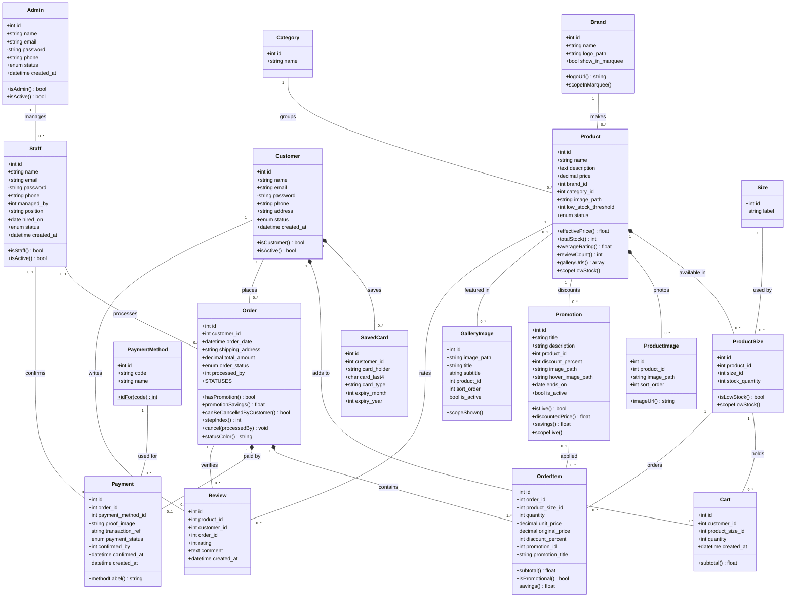

# SlayNa Sneaker Store — Class Diagram

UML class diagram of the Eloquent models in `app/Models`. Each class is one
database table; attributes are the table's columns (from `database/migrations`)
and methods are the public model methods (relationships are drawn as
associations). A filled diamond (`*--`) marks a cascade-delete composition.

Admin, Staff and Customer are separate tables, each with its own login guard
(`admin`, `staff`, `web` in `config/auth.php`). An email can only belong to one
of them.

**Keep this file and the database in sync:** any table or column change here
needs a migration, and any migration that changes the schema needs this
diagram updated.

GitHub and VS Code (with a Mermaid extension) render this diagram directly.

| Class | Table |
|---|---|
| Admin | `admins` |
| Staff | `staff` |
| Customer | `customers` |
| SavedCard | `saved_cards` |
| Cart | `carts` |
| Order | `orders` |
| OrderItem | `order_items` |
| Payment | `payments` |
| PaymentMethod | `payment_methods` |
| Review | `reviews` |
| Product | `products` |
| ProductSize | `product_sizes` |
| ProductImage | `product_images` |
| Promotion | `promotions` |
| GalleryImage | `gallery_images` |
| Brand | `brands` |
| Category | `categories` |
| Size | `sizes` |

