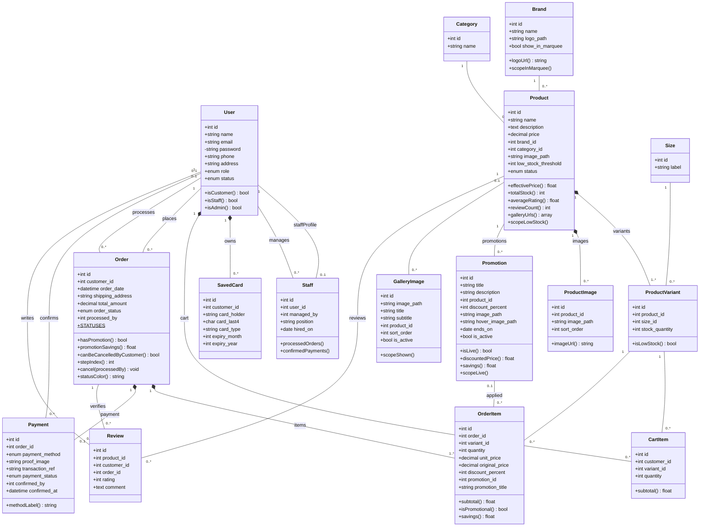

# SlayNa Sneaker Store — Class Diagram

UML class diagram of the Eloquent models in `app/Models`. Attributes come from
`database/migrations`; methods are the public model methods (relationship
accessors are shown as associations). A filled diamond (`*--`) marks a
cascade-delete composition.

GitHub and VS Code (with a Mermaid extension) render this diagram directly.

